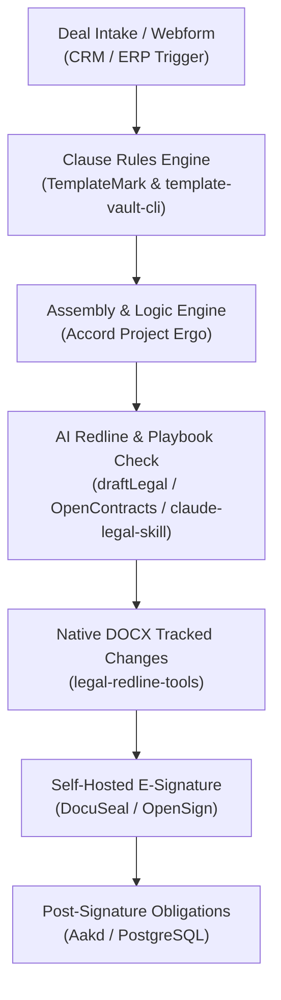

# ⚡ Awesome Dynamic Commercial Contract Draft Engines

  

  
  
  
  
  

> 📜 A curated list of leading enterprise SaaS platforms and self-hosted open-source repositories powering dynamic commercial contract draft engines, modular clause generation, automated redlining, smart legal templates, and Contract Lifecycle Management (CLM).

---

## 📑 Table of Contents

- [📌 Overview](#-overview)
- [📈 Sector Overview & Market Dynamics](#-sector-overview--market-dynamics)
- [🏢 Enterprise SaaS Contract Engines](#-enterprise-saas-contract-engines)
- [💻 Open-Source Contract Draft Engines & Tooling](#-open-source-contract-draft-engines--tooling)
- [🏗️ Frameworks for Custom Contract Engines](#️-frameworks-for-custom-contract-engines)
- [🤝 How to Contribute](#-how-to-contribute)
- [💖 Support](#-support)
- [📊 Star History](#-star-history)
- [⚖️ Disclaimer](#️-disclaimer)

---

## 📌 Overview

Modern commercial transactions require generating bespoke, deal-specific agreements without sacrificing institutional playbook standards. **Dynamic Commercial Contract Draft Engines** enable legal, procurement, and deal teams to auto-generate targeted contracts by dynamically assembling modular clauses, evaluating deal metadata, applying conditional logic, and embedding AI-assisted redlines into execution workflows.

---

## 📈 Sector Overview & Market Dynamics

The global Contract Lifecycle Management (CLM) and contract drafting engine market is valued at approximately **$1.8B – $2.8B** and is projected to expand at a compound annual growth rate (**CAGR of 11%–14%**) to over **$5.5B+ by the early 2030s**, propelled by enterprise adoption of Generative AI, clause automation, and risk mitigation.

The sector is currently **moderately fragmented, but actively consolidating**: while niche AI point solutions (redlining assistants, Word add-ins, signature layers) proliferate, dominant enterprise CLM platforms and workflow giants (e.g., Docusign's acquisition of Lexion, Workday's acquisition of Evisort) continue absorbing vertical capabilities to offer end-to-end contract drafting, negotiation, and execution suites.

---

## 🏢 Enterprise SaaS Contract Engines

The following table compares category-defining commercial SaaS platforms offering dynamic contract drafting, clause libraries, automated playbook review, and end-to-end CLM. Platforms are sorted in descending order by estimated enterprise scale (valuation or acquisition value / annualized revenue).

| Platform | Company Size (Valuation / Revenue) | Pricing (Starting Tier) | Free Tier / Trial Limits | Core Drafting & Assembly Capabilities |
| :--- | :--- | :--- | :--- | :--- |
| **[Ironclad](https://ironcladapp.com/)** | **$3.2B Valuation** (~$200M+ ARR) | Quote-based; custom enterprise deployments (typically starts ~$800–$1,000/mo billed annually) | No free tier; demo sandbox available upon sales qualification | 🏛️ Enterprise CLM platform with Workflow Designer, AI-assisted drafting, conditional clause logic, playbook guardrails, and integrated e-signature. |
| **[LinkSquares](https://linksquares.com/)** | **$800M Valuation** (Raised ~$164M) | Modular packaging; starting packages typically begin at ~$30,000/year | No free tier or self-serve trial; live sales-guided platform walkthrough available | 🔍 AI contract intelligence and drafting hub (Analyze + Finalize + Sign) featuring smart clause extraction, risk assessment, and template automation. |
| **[Evisort](https://www.evisort.com/)** | **$615M Valuation** (Acquired by Workday; ~$15M ARR) | Enterprise quote-based; custom packages via Workday enterprise sales | No free tier or self-serve trial; custom POC provided upon enterprise scoping | 📊 AI contract analytics and drafting engine; extracts historical terms and playbook standards to assemble and benchmark deal drafts. |
| **[SpotDraft](https://www.spotdraft.com/)** | **~$400M Valuation** (~$15M ARR) | Quote-based; entry-level mid-market plans typically start ~$18,000–$20,000/year | No free tier; personalized sandbox trial available during sales evaluation | 📝 End-to-end CLM with automated modular drafting, clause library enforcement, dynamic questionnaire-based generation, and collaborative redlining. |
| **[Spellbook](https://www.spellbook.legal/)** | **$350M Valuation** (~$20M+ ARR) | Paid plans start at **$99/user/month** (billed annually) up to ~$249–$299/user/month for Pro/Firm tiers | **7-day free trial** with full Word add-in features and limited AI token/clause generation quota | ✨ Native Microsoft Word AI co-pilot; drafts deal-tailored clauses, detects missing terms, auto-generates redlines, and enforces firm playbooks. |
| **[ContractPodAi (Leah)](https://contractpodai.com/)** | **~$250M Valuation** (~$47M ARR; raised $179M) | Enterprise subscription; entry deployments start at ~$50,000/year | No free tier; sales-guided pilot environment available on request | 🧠 GenAI-native legal copilot (*Leah*) embedded in full-suite CLM; provides clause assembly, interactive playbook redlining, and risk scores. |
| **[Robin AI](https://www.robinai.com/)** | **~$150M Valuation** (~$10M–$15M ARR) | Paid plans start at **$5,000/year** for small teams; custom enterprise tiers | **Free tier available**: 1 user seat, up to **5 contracts/month**, and **10 AI queries/day** | 🤖 Combines Anthropic Claude-backed legal LLMs with lawyer-in-the-loop review, clause repositioning, and Word-integrated contract drafting. |
| **[Lexion](https://www.lexion.ai/)** | **$165M Acquisition** (Acquired by Docusign) | Modular enterprise pricing (integrated into Docusign IAM suites) | No free tier or self-serve trial; enterprise demo and guided sandbox on request | 📬 Intake-driven drafting workflows, AI clause extraction, automated contract repository indexing, and redline negotiation pipelines. |
| **[Juro](https://juro.com/)** | **~$100M Valuation** (Raised ~$35M) | Tiered plans start at **$125/user/month** (annual contract; minimum seat requirements apply) | **14-day guided free trial** (up to 10 automated test contracts and standard browser editor access) | ⚡ In-browser contract automation engine; dynamic templates with conditional branching, data validation tables, and native signing. |
| **[Malbek](https://malbek.com/)** | **~$50M Valuation** (~$12M ARR; raised ~$20M) | Quote-based; core mid-market tiers typically start around **$20,000/year** | No self-serve free tier; trial environments available on request during procurement evaluation | 🔄 Modular CLM with *Malbek AI* drafting and *BusinessIQ* clause analytics, multi-tier approvals, and bi-directional ERP/CRM sync. |

---

## 💻 Open-Source Contract Draft Engines & Tooling

For legal engineering teams, developers, and privacy-sensitive enterprises, open-source tools provide transparent, auditable clause libraries, self-hosted LLM redlining agents, and vendor-independent drafting pipelines.

The repositories below are **sorted in descending order by GitHub_Stars**:

| Repository | GitHub_Stars | License | Primary Architectural Role & Focus |
| :--- | :--- | :--- | :--- |
| **[DocuSeal](https://github.com/docusealco/docuseal)** |  | AGPL-3.0 | ✍️ Self-hosted document signing and form-filling execution engine; provides open-source alternative to DocuSign for contract execution pipelines. |
| **[OpenSign](https://github.com/OpenSignLabs/OpenSign)** |  | AGPL-3.0 | 🔏 Open-source e-signature solution built with Parse Server and React; exposes REST APIs for programmatic contract dispatch and signing. |
| **[OpenContracts](https://github.com/Open-Source-Legal/OpenContracts)** |  | Apache-2.0 | 📑 Open-source document intelligence and contract analytics platform with agentic PDF/DOCX parsing, layout analysis, vector embeddings, and clause annotation. |
| **[claude-legal-skill](https://github.com/evolsb/claude-legal-skill)** |  | MIT | 🎯 AI contract review and drafting skill integrating CUAD risk detection, market clause benchmarks, and lawyer-ready automated redlines across AI IDEs. |
| **[Accord Project: Template Archive](https://github.com/accordproject/template-archive)** |  | Apache-2.0 | 📦 Standardized smart legal contract templates for Cicero / TemplateMark; provides open standards for parameter-driven clause assembly and execution. |
| **[The Plain Contract](https://github.com/jackmorgan/the-plain-contract)** |  | CC-BY-4.0 | 📖 Crowdsourced, modular freelance and commercial service contract template written in accessible plain English with interchangeable clause blocks. |
| **[contract-review-pro](https://github.com/CSlawyer1985/contract-review-pro)** |  | MIT | 🛡️ Professional contract audit skill for AI agents structured on formal legal contract review methodology, risk grading, and counter-clause drafting. |
| **[Accord Project: Ergo](https://github.com/accordproject/ergo)** |  | Apache-2.0 | ⚙️ Formally defined, domain-specific programming language for executable legal contract logic and deterministic clause-level computational enforcement. |
| **[Wraft](https://github.com/wraft/wraft)** |  | GPL-3.0 | 🗂️ Git-inspired document lifecycle management platform offering granular version tracking, revision branches, and collaborative legal drafting. |
| **[Contract-Builder](https://github.com/blopa/Contract-Builder)** |  | MIT | 🧩 Interactive web application for building, customizing, and exporting modular legal contracts from dynamic variable forms. |
| **[Ally Legal Assistant](https://github.com/Azure-Samples/ally-legal-assistant)** |  | MIT | 🤖 Microsoft Word plugin powered by Azure OpenAI for clause analysis, interactive contract Q&A, and real-time tracked-changes markup. |
| **[Vaquill MS Word Add-in](https://github.com/Vaquill-AI/ms-word-addin)** |  | Apache-2.0 | 📝 Open-source MS Word legal assistant task-pane add-in supporting playbook-guided drafting, clause suggestions, and legal research. |
| **[legal-redline-tools](https://github.com/evolsb/legal-redline-tools)** |  | MIT | 🖍️ Programmatic utilities for converting AI review output directly into native Word (.docx) tracked changes and redline PDFs. |
| **[contract-review-agent](https://github.com/lowtidebuild/contract-review)** |  | MIT | 🕵️ Local-first AI agent parsing agreements into clause-level risk assessments with automated tracked-change DOCX generation. |
| **[Accord Project: Template Engine](https://github.com/accordproject/template-engine)** |  | Apache-2.0 | 🚂 The core parsing and rendering engine transforming TemplateMark markdown legal agreements into structured JSON data models and vice versa. |
| **[draftLegal](https://github.com/AniketTati/draft-legal)** |  | AGPL-3.0 | 🔐 Self-hosted, AI-native CLM platform (Ironclad + Harvey alternative) featuring 8 specialized background agents, hybrid retrieval (pgvector + ES), and local LLM redlining. |
| **[Aakd](https://github.com/aaked-app/aakd)** |  | AGPL-3.0 | 📌 Self-hosted contract operations platform; extracts facts and obligations with page-level citations and provides scoped MCP endpoints for AI agent workflows. |

### 🛠️ Supplementary Open-Source & Package Ecosystem
- **[template-vault-cli](https://pypi.org/project/template-vault-cli/)** *(Python CLI)* — Git-backed, clause-aware legal document template manager allowing teams to fork, swap clauses, and preserve clause provenance.
- **[Codify](https://pypi.org/project/codify-core/)** *(Python/MCP)* — Open legal codification tool with Model Context Protocol (MCP) server for AI agent provision search and comparison.
- **[@petalo/contracts-wizard](https://www.npmjs.com/package/@petalo/contracts-wizard)** *(npm)* — Command-line interface for dynamic contract generation from modular Handlebars templates.
- **[华炎合同管理系统](https://www.npmjs.com/package/app-contracts-cl2)** *(npm)* — Low-code Chinese contract management platform supporting counterparty tracking, approval flows, and dynamic contract components.

---

## 🏗️ Frameworks for Custom Contract Engines

To build a private, enterprise-ready dynamic commercial contract draft engine without vendor lock-in, consider orchestrating these best-of-breed open-source building blocks:

1. **Template & Schema Layer**: Use **[Accord Project](https://github.com/accordproject/template-archive)** (`TemplateMark` & `Concerto`) or **[template-vault-cli](https://pypi.org/project/template-vault-cli/)** for Git-backed clause versioning and template modularity.
2. **Logic & Computation**: Use **[Ergo](https://github.com/accordproject/ergo)** for executing deterministic conditions, discount calculations, and compliance rules.
3. **AI Drafting & Playbook Enforcement**: Deploy **[draftLegal](https://github.com/AniketTati/draft-legal)** or **[OpenContracts](https://github.com/Open-Source-Legal/OpenContracts)** with your private LLM endpoint (Ollama / vLLM / Gemini / Claude).
4. **Redline Generation**: Integrate **[legal-redline-tools](https://github.com/evolsb/legal-redline-tools)** to compile AI suggested edits into standard Microsoft Word tracked-change revisions.
5. **Execution & Signature**: Route output documents to self-hosted **[DocuSeal](https://github.com/docusealco/docuseal)** or **[OpenSign](https://github.com/OpenSignLabs/OpenSign)**.
6. **Post-Signature Obligation Tracking**: Ingest signed artifacts into **[Aakd](https://github.com/aaked-app/aakd)** to map audit rights, renewal notices, and milestone obligations.

---

## 🤝 How to Contribute

Contributions are welcome! Please help keep this legal tech resource comprehensive and up-to-date:

1. **Fork the repository** 🍴.
2. **Create a branch**: `git checkout -b feature/add-engine-or-tool` 🌿.
3. **Add or update entries**: Follow the existing table formatting (ensure pricing, free tier/trial limits, valuation/revenue, or GitHub Stars_Badges are provided) 📝.
4. **Commit changes**: `git commit -m "Add [Engine Name] to list"` 💾.
5. **Open a Pull Request** with a brief summary of why the tool fits the dynamic contract drafting category 🚀.

---

## 💖 Support

Thank you for visiting and using this curated resource! If you find this repository helpful for your legal engineering work, research, or enterprise evaluations, please consider supporting the project:

- ⭐ **Star** this repository to help others discover it.
- 🍴 **Fork** and contribute new tools, updates, or benchmarks.
- 📢 **Share** it with your fellow legal tech engineers, legal ops teams, and developers.
- ☕ **Buy me a coffee**: Support ongoing maintenance and curated updates via the [GitHub Sponsors Dashboard](https://github.com/sponsors/ishandutta2007).

---

## 📊 Star History

---

## ⚖️ Disclaimer

- This repository is a community-curated directory intended for research, software architecture, and evaluation purposes; it does not constitute legal advice.
- Commercial contract drafting engines and AI models must be validated by licensed attorneys to ensure professional responsibility compliance and jurisdiction-specific enforceability.
- All trademarks and product names belong to their respective copyright holders.
